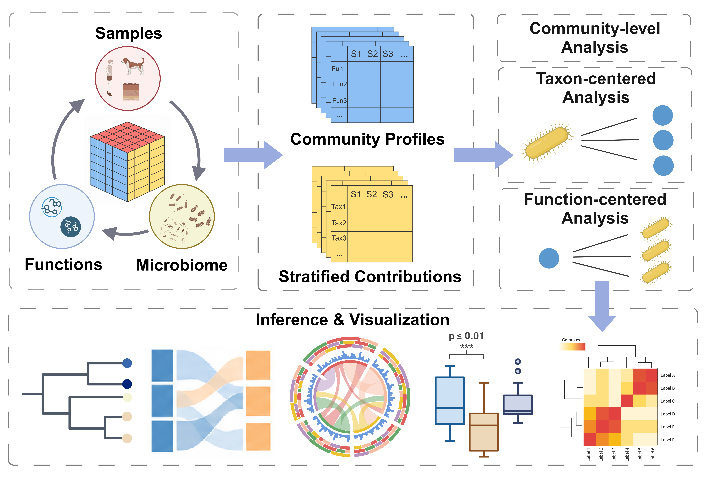

# MicroFun 

MicroFun is an R package for differential analysis and visualization of taxon-stratified microbial functional profiles predicted by PICRUSt2. It integrates functional contribution tables with `phyloseq` data to explore predicted functions within taxa (taxon-to-function) and taxonomic contributors to functions (function-to-taxon).

[Documentation and tutorials](https://bioscinema.github.io/MicroFun_website_tutorials/) · [Study data](https://bioscinema.github.io/MicroFun_website_tutorials/articles/study-data.html) · [GitHub](https://github.com/bioscinema/MicroFun_0.1.0)

## Graphical abstract



## Features

- Taxon-centered and function-centered differential analyses from stratified PICRUSt2 contributions.
- KO, EC, MetaCyc and KEGG pathway annotation and aggregation.
- Class-to-Genus and other supported taxonomy-rank analyses, depending on the input taxonomy.
- Sankey and chord diagrams, boxplots, association dendrograms and effect-size visualizations.
- Community-level PCA, heatmaps and abundance summary plots.

## Installation

```r
install.packages("remotes")
remotes::install_github("bioscinema/MicroFun_0.1.0", dependencies = TRUE)
library(MicroFun)
```

For Bioconductor dependencies and reproducible versions, see the [installation guide](https://bioscinema.github.io/MicroFun_website_tutorials/articles/installation.html).

## Example: Riquelme 2019 demonstration

The official study uses the MDA cohort (22 short-term and 21 long-term survivors) from Riquelme et al. (2019). After downloading and assembling the files described in [Study data and downloads](https://bioscinema.github.io/MicroFun_website_tutorials/articles/study-data.html), the Class-level taxon-centered analysis is:

```r
library(MicroFun)
library(phyloseq)

data_dir <- "MicroFun_demonstration_data"
study <- new.env()
load(file.path(data_dir, "phyloseq_asv.RData"), envir = study)

ps <- prune_samples(sample_data(study$ps)$Cohort == "MDA", study$ps)
ps <- prune_taxa(taxa_sums(ps) > 0, ps)

result_taxa <- pathway_sdaa(
  stratified_path = file.path(data_dir, "stratified", "KO_contrib.tsv.gz"),
  physeq = ps,
  taxon_level = "Class",
  group = "group",
  direction = "taxa",
  pathway = "KO",
  daa_method = "Maaslin2",
  reference = "STS",
  p.adjust.method = "BH",
  threshold = 0.05
)

p <- tax2fun_sankey(result_taxa, tree_mode = "taxonomy", physeq = ps)
save_sankey(p, "tax2fun_taxonomy.html")
```

The [Standard demonstration](https://bioscinema.github.io/MicroFun_website_tutorials/articles/demonstration-standard.html) covers community-level KO and KEGG analyses; the [Stratified demonstration](https://bioscinema.github.io/MicroFun_website_tutorials/articles/demonstration-stratified.html) covers both taxon-centered and function-centered analyses using selected KOs and several visualization methods.

## Authors

Ruitao Liu, Yaoran Yu, Chenyu Liu, Zilin Li and Liangliang Zhang.

Corresponding author: [Liangliang Zhang](mailto:lxz716@case.edu).

Maintainers: [Yaoran Yu](mailto:yxy1625@case.edu), [Chenyu Liu](mailto:cxl1299@case.edu) and [Zilin Li](mailto:zxl1715@case.edu).

## License

MIT. See [LICENSE](LICENSE).
